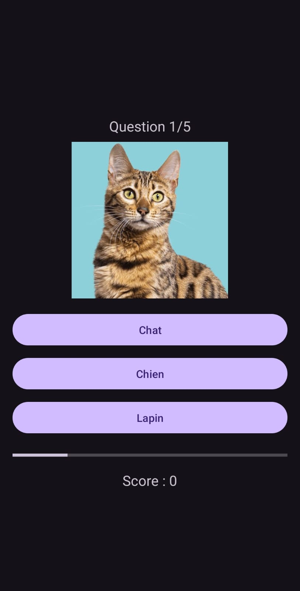

# Quiz App

Application Android permettant à l’utilisateur de répondre à un quiz (QCM) et d’obtenir son score final.

## Fonctionnalités
- Connexion utilisateur
- Liste des produits (ou questions selon ton TP)
- Sélection d’une réponse parmi plusieurs propositions
- Calcul automatique du score
- Affichage du résultat final
- Bouton **Rejouer** pour recommencer

## Technologies
- Kotlin, Jetpack Compose
- Min SDK 24 / Target SDK 36
- Android Studio

## Installation
1. Cloner le dépôt
2. Ouvrir avec Android Studio
3. Ajouter vos clés dans `local.properties` (si nécessaire, ex: API_KEY)
4. Lancer sur un émulateur ou un appareil physique

## Captures d’écran

## Auteur
Triki Mohamed Amine – ISET Djerba / Groupe 2
